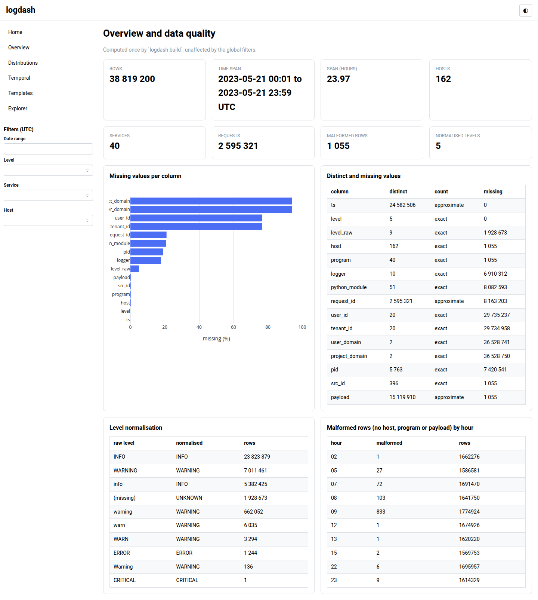
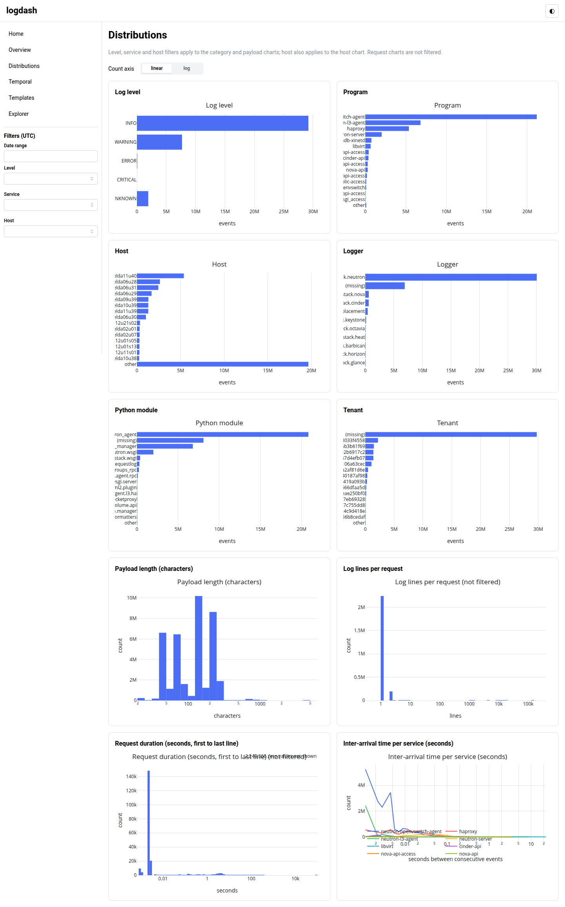
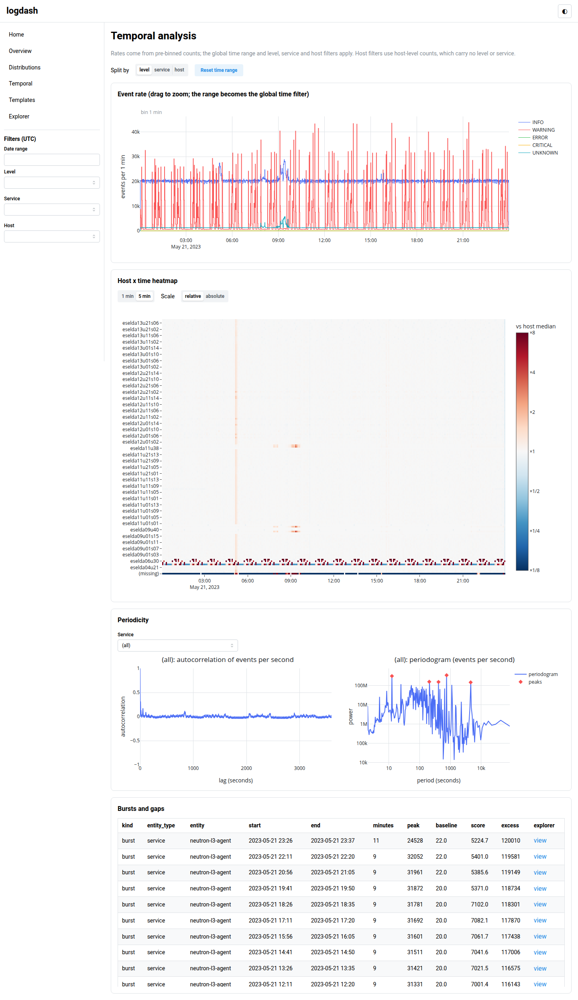
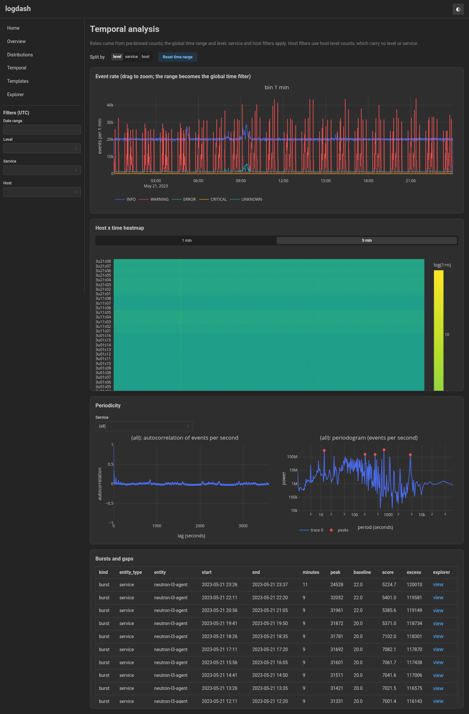
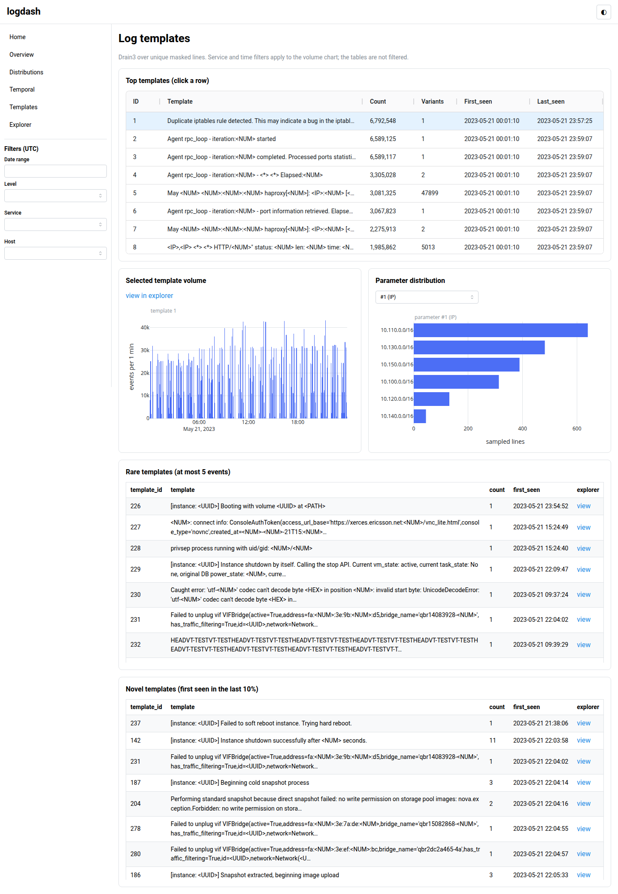
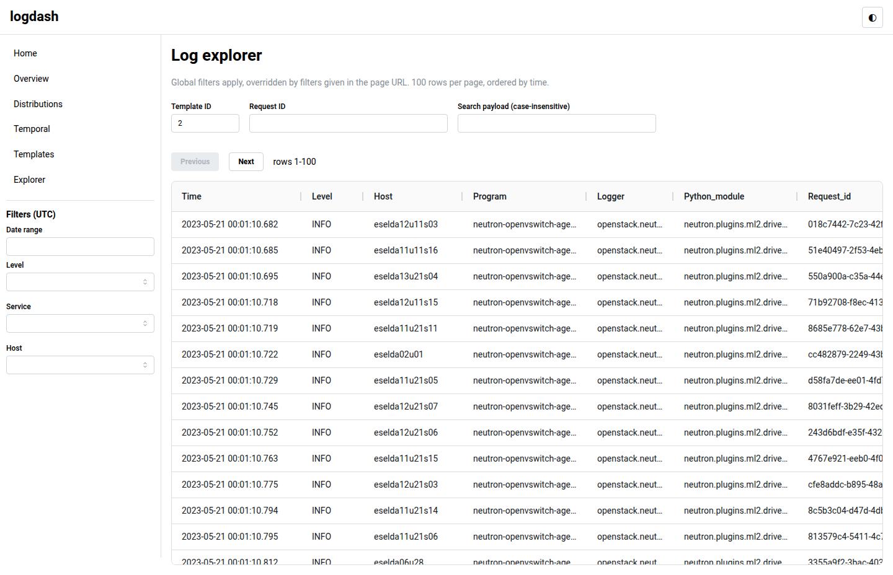

# logdash

Interactive dashboard for analysing the OpenStack log dataset in `data/`
(38.8 M log lines, 24 h, 162 hosts, 40 services). Expensive work runs once in a
precompute step that writes Parquet and JSON to `cache/`; the Dash app only reads
that cache and answers every interaction in well under 300 ms on a laptop.
See [PLAN.md](PLAN.md) for the design and status.

## Data

`data/flog-data_*_preprocessed.csv.zst` (759 MB compressed, about 13 GB as CSV):
Unix timestamp, log level, program, host, logger, Python module, request, user and
tenant ids, pid and the free-text payload. Levels are mixed case, 1,055 rows are
malformed (flagged, kept) and the payload is highly templated. Time is handled in UTC.
`data/` and `cache/` are git-ignored.

## Quick start

```bash
uv sync                  # install
uv run logdash build     # precompute into cache/ (only stale stages)
uv run logdash serve     # build if stale, then serve on http://127.0.0.1:8050
```

Other commands:

```bash
uv run logdash build --only templates --force   # rebuild one stage
uv run logdash build --strict                   # fingerprint file content, not mtime
uv run logdash status                           # cache state per stage
uv run logdash serve --no-build --port 8051     # serve the existing cache as is
```

### Build time and cache size

Reference laptop (16 cores, 31 GB RAM, DuckDB limited to 8 GB / 8 threads), real data:

| Stage | Time |
|---|---|
| events (normalised, hour-partitioned Parquet) | 97 s |
| overview, distributions, temporal, templates, explorer | under 8 s each (measured before the templates stage also wrote the per-host counts) |
| features | about 1 s for a synthetic 600k-row template count table (not yet measured on the real data) |
| pca | 12 fits (group x window x scaling); about 4 s for a synthetic 230k-window x 281-template matrix at 3 % density (not yet measured on the real data) |
| anomalies | 0.2 s (one detector: PCA residual; 6,676 rows, 1,676 per service and 5,000 per host) |
| total | 1 min 58 s (measured before the features, pca and anomalies stages existed) |

`cache/` is 622 MB (281 templates from 73,583 unique masked lines).

## Pages

| Page | Content |
|---|---|
| Overview | data quality: rows, span, missing values per column, level normalisation, malformed rows |
| Distributions | level, program, host, logger, module, tenant, payload length, lines per request, request duration, inter-arrival times; linear/log |
| Temporal | event rate (1 s to 5 min bins by zoom), host x time heatmap, autocorrelation and periodogram, bursts and gaps; drag on the rate chart to set the global time range |
| Templates | Drain3 templates: top, volume over time, parameter distributions, rare and novel lists |
| Features | window x template count matrix (1, 5, 15 min; per service or host; log1p or TF-IDF): template correlation heatmap, template-entity association, variance ranking, mutual information |
| PCA | PCA of the window x template matrix (precomputed per grouping, window and scaling): scree plot, 2D and 3D projections coloured by time, service or host, or SPE; loadings per component; residual SPE per window against its control limit, and the windows above it with their top residual templates |
| Anomalies | every registered detector's anomalies: score timeline coloured by type, per-type filter, table sortable by score, time, type or entity, with a link per row to the raw lines of its window in the explorer |
| Explorer | paged grid over raw events with filters, template, request id and text search; other pages link here |

Global filters (date range, level, service, host) live in the sidebar. The time
range is respected by Temporal, Templates, Features, PCA, Anomalies and Explorer; the other pages state which
filters they honour.

Screenshots (`docs/screenshots/`):








## Anomaly scores from PCA

The `pca` stage keeps, for every grouping (`service`, `host`), window (60, 300, 900 s) and
scaling (`log1p`, `tfidf`), the per-window SPE (squared norm of what the first `k`
components, keeping 95 % of the variance, do not explain) with its Jackson-Mudholkar control
limit (Gaussian theory at 99.9 %: a reference line, not a false-alarm rate), and the three templates that contribute most to each window's residual.
Downstream modules read them with `pca.load_spe(store, group, window_s, scaling)`
(`row, bin, entity, spe, limit, ratio`; rank by `ratio = spe / limit` rather than the flag) and `pca.load_residuals(...)`
(`row, rank, template_id, residual, share`); `row` is the row of the features index.

## Adding an anomaly detector

Anomaly detection (module 6) has a framework and a page; the detectors are plug-ins. Create
`src/logdash/detectors/<name>.py` with a class implementing `Detector` from
`detectors/base.py` and decorate it with `@register`. Nothing else changes: the package imports
every module in `detectors/`, the `anomalies` stage runs all registered detectors, and the page
follows the data (type filter, timeline, table, explorer links).

- Attributes: `key` (value of the `detector` column), `type` (anomaly type; several detectors
  may share one, for example `structural`), `title`, `version`, `depends_on` (analyses whose
  cache it reads; the stage depends on the union and is rebuilt when a version changes),
  `threshold` (raw score at which a row counts as anomalous, above 0) and optionally
  `setting_names`. Planned types: `volume`, `contextual`, `structural`, `novel`, `sequence`,
  `severity`.
- `detect(ctx)` gets a `DetectContext` (`store`, `settings`, `log`) and returns a polars frame
  with `bin` (window start, UTC), `window_s`, `kind` (`service`, `host` or `request`; what
  `entity` is), `entity`, `raw` (larger is more anomalous), `evidence` (text) and optionally
  `template_id`. Read other stages through `ctx.store` (for example `pca.load_spe`).
- `cache/anomalies/anomalies.parquet` has one row per anomaly: `detector, type, bin, window_s,
  kind, entity, template_id, raw, score, evidence`. The framework drops rows with `raw` below
  the detector's threshold, keeps the 20,000 highest per detector and normalises the score to
  `[0.5, 1]` as `1 - threshold / (2 raw)`: 0.5 is the detector's own threshold, 0.75 twice
  that, and so on, so types with different raw units rank together. `meta.json` lists each
  detector with its row count and time.
- The page links each row to `/explorer?start=&end=&service=|host=|request_id=[&template=]`
  for the anomaly's window and entity.

The one detector so far, `structural_pca.py`, is the PCA residual half of the structural type:
windows of the per-service and per-host 1-minute log1p fits with `spe / limit` of at least 1
(highest 5,000 per grouping), with the top residual templates as evidence. Issue 6 adds the
Isolation Forest next to it.

## Adding an analysis

Create `src/logdash/analyses/<name>.py` with a class implementing the `Analysis`
protocol from `analyses/base.py`:

- `key` (cache subdirectory and URL path), `title`, `version` (bump to invalidate
  the cache), `depends_on` (upstream keys), optional `setting_names` (settings that
  enter the fingerprint);
- `compute(ctx)` writes Parquet/JSON into `ctx.out_dir` using `ctx.con` (DuckDB with
  the `events` view); `layout(store)` returns the page; `register_callbacks(app, store)`.

Decorate the class with `@register` and add the module name to `BUILTIN` in
`analyses/__init__.py`. The shell builds navigation and pages from the registry and
`logdash build` runs stale stages in dependency order.

Conventions:

- Component ids are prefixed with the key (`temporal-rate`). Take the global filters
  from `FILTER_STORE_ID` via `from_dict`, and the theme from `THEME_STORE_ID`; pass the
  theme to figure builders (`app/figures.py`).
- Callbacks read pre-binned aggregates; query `events` only with `LIMIT` and pushed-down
  hour filters (see the rules in PLAN.md 4.4). Never interpolate user values into SQL
  (`where_clause` parameterises).
- Keep work in pure functions (`compute_*`, `*_figure`) and callbacks thin. Use
  `app/ui.py` helpers for pages, cards and tables.
- Tests: build the stage on the synthetic data (`built` and `build_with` in
  `tests/conftest.py`), assert on figure data and call callbacks directly. Coverage must
  stay at or above 90 %.

## Configuration

Environment variables; CLI flags (`--data`, `--cache`, `--memory-limit`, `--threads`) override.

| Variable | Default | Meaning |
|---|---|---|
| `LOGDASH_DATA` | `data` | directory with `*.csv.zst` |
| `LOGDASH_CACHE` | `cache` | precompute output |
| `LOGDASH_MEMORY_LIMIT` | `8GB` | DuckDB memory limit |
| `LOGDASH_THREADS` | `8` | DuckDB threads |
| `LOGDASH_BURST_K` | `6` | burst threshold in robust sigmas above the rolling median |
| `LOGDASH_GAP_MINUTES` | `10` | silent minutes that make a gap |
| `LOGDASH_DRAIN_SIM_TH` | `0.4` | Drain3 similarity threshold |
| `LOGDASH_DRAIN_DEPTH` | `4` | Drain3 tree depth |
| `LOGDASH_TEMPLATE_TOP_K` | `50` | templates with parameter extraction |
| `LOGDASH_PARAM_SAMPLE` | `2000` | payloads sampled per top template |
| `LOGDASH_RARE_THRESHOLD` | `5` | a template with at most this many events is rare |
| `LOGDASH_NOVEL_FRACTION` | `0.1` | novel: first seen in the last fraction of the span |

## Tests

```bash
uv run pytest                      # unit and integration tests, 90 % coverage gate
uv run pytest -m slow --no-cov     # latency benchmark on the real ./cache (skipped if absent)
uv run ruff check . && uv run ruff format --check . && uv run mypy src
```

The benchmark times every page layout and callback (no filter, one hour, host,
template, text search, brushing, anomaly types and sorts) and asserts each is under 300 ms; run it with `-s`
to see the timing table.

## Building elsewhere

`cache/` is plain Parquet and JSON and portable. Run `uv run logdash build` on a
bigger machine (set `LOGDASH_THREADS` and `LOGDASH_MEMORY_LIMIT`), copy the whole
`cache/` directory to the laptop and run `uv run logdash serve --no-build`. The app
never reads `data/`.
